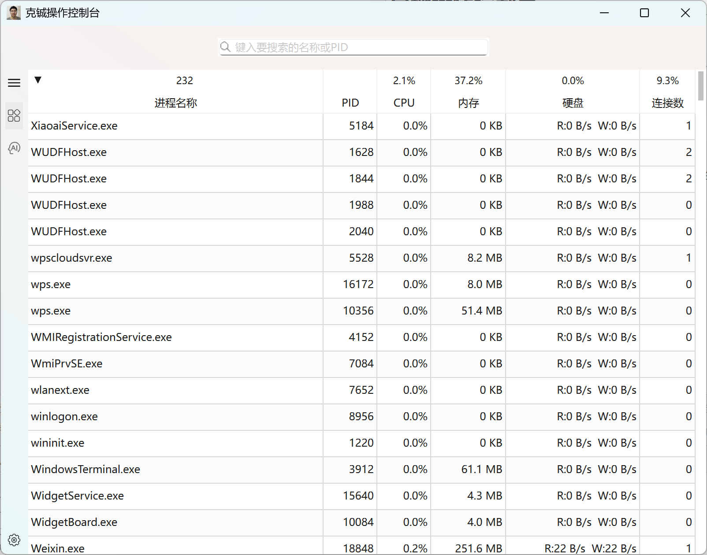
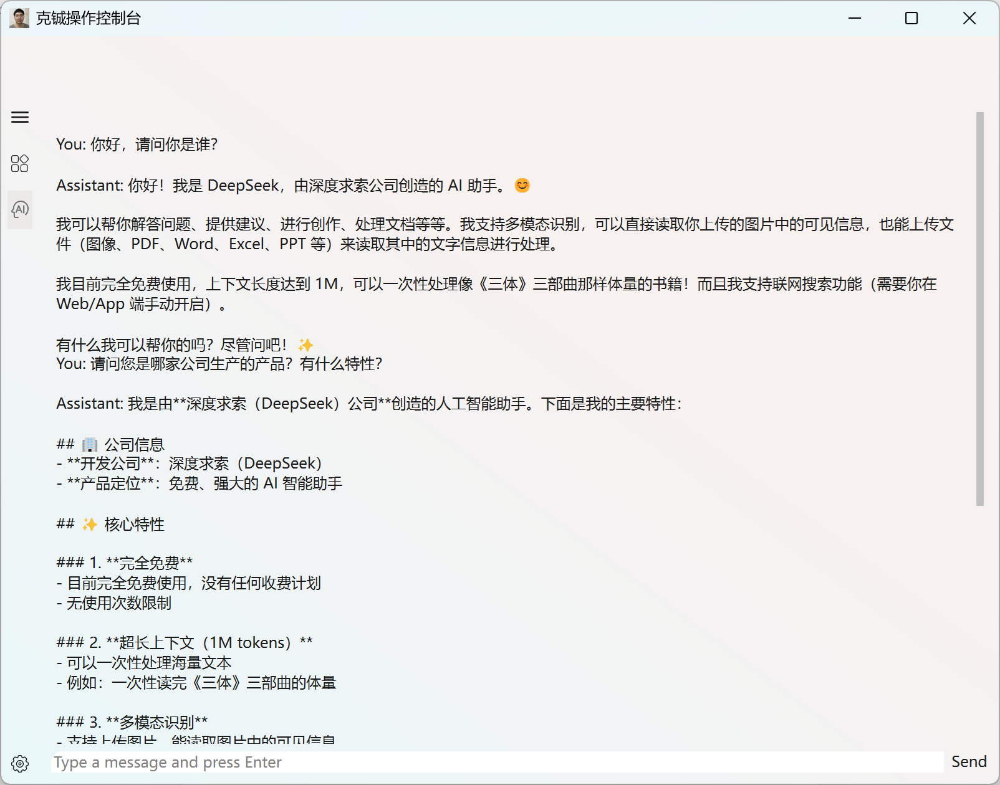

# 克铖操作控制台

打造一款轻量、现代、高效的 Windows 系统监控与操作工具。

> 基于 Qt 6 / C++17 构建的 Windows 桌面应用，提供实时进程监控、系统资源概览，以及内置的 AI 对话与命令执行助手。

## 项目简介

克铖操作控制台（KCSystemConsole）是一款 Task-Manager 风格的 Windows 系统监控工具。应用采用 Qt Widgets 构建界面，通过 Win32 API 采集进程级 CPU、内存、磁盘 I/O 和网络连接数据，并以可排序表格的形式实时展示。

除系统监控外，应用还内置了 AI 对话面板，兼容 DeepSeek 等 OpenAI 风格接口，支持流式回复、多轮对话，以及通过白名单命令工具完成查看目录、读取文件、创建文件/目录等实际操作。

## 功能特性

- **实时进程监控**：每 5 秒自动刷新进程列表，启动时立即执行一次采集。
- **多维度进程指标**：
  - 进程名称与 PID
  - CPU 占用率（多核进程可能超过 100%）
  - 内存占用（优先使用私有工作集，失败时回退到总工作集）
  - 磁盘读写速率（基于相邻采样差值计算）
  - 网络连接数（统计 IPv4/IPv6 的 ESTABLISHED TCP 连接及 UDP 连接）
- **双行表头统计**：表头上方汇总进程数量、总 CPU、内存使用率、磁盘活动百分比和网络连接百分比。
- **数值排序**：数值列使用自定义 `NumericTableItem` 排序键，避免按字符串排序导致的错误；刷新时保留当前排序状态与滚动位置。
- **响应式列宽**：窗口缩放、滚动条变化或菜单折叠/展开时，按比例重新分配列宽。
- **可折叠侧边菜单**：进程、AI、设置三个页面通过左侧菜单切换，菜单支持展开/收起。
- **全局样式与国际化**：通过 `global.qss` 统一界面风格，并预留 Qt 翻译（简体中文）支持。
- **AI 对话助手**：支持流式输出、多轮上下文和工具调用，可执行受限的白名单命令。

## 目标用户群体

硬件爱好者，软件发烧友，操作系统极客

### 核心定位

实时系统性能监控 + 进程/服务/启动项管理 + 简单AI问答

> 当前版本已实现实时进程监控与 AI 问答；服务管理和启动项管理为后续规划方向。

## 技术栈

| 类别 | 技术 |
| --- | --- |
| 开发语言 | C++17 |
| 界面框架 | Qt 6 Widgets（兼容 Qt 5 的 CMake 分支，未完整验证） |
| 构建系统 | CMake 3.16+ |
| 网络能力 | Qt Network，LLMQore |
| 并发能力 | Qt Concurrent、QThread |
| 系统接口 | Win32 API（`psapi`、`iphlpapi`、`tlhelp32`、`winsock2`） |
| AI 客户端 | LLMQore（OpenAI 兼容客户端） |
| 资源与样式 | Qt Resource System（`.qrc`）、QSS |
| 国际化 | Qt Linguist（`qt_create_translation`） |

## 项目结构

```text
KCSystemConsole-demo1-ui/
├── main.cpp                     # 程序入口：加载全局样式与翻译
├── mainwindow.h/.cpp/.ui        # 主窗口、左侧菜单、进程表格与汇总逻辑
├── processinfocollector.h/.cpp  # Win32 进程数据采集（CPU/内存/磁盘/网络）
├── ChatWindow.h/.cpp            # AI 对话面板
├── ExecuteCommandTool.hpp       # AI 命令执行工具（白名单）
├── NumericTableItem.h           # 支持数值排序的表格项
├── TwoRowHeaderView.h/.cpp      # 双行表头
├── CMakeLists.txt               # CMake 构建配置
├── QSSResources.qrc             # 样式资源
├── imageResources.qrc           # 图片资源
├── KCSystemConsole-demo1-ui_zh_CN.ts  # 翻译源文件
├── styles/                      # 全局 QSS 样式
├── images/                      # 图标与界面图片
├── fonts/                       # 字体资源
├── docs/demonstration/          # 演示截图
├── include/LLMQore/             # LLMQore 头文件（第三方依赖）
└── libs/                        # LLMQore 预编译库及运行时 DLL
```

## 环境要求

- **操作系统**：Windows（代码直接调用 Win32 API，不支持 Linux/macOS）
- **Qt**：Qt 6.11.1 MinGW 64-bit（Qt Creator Kit：`qt.qt6.6111.win64_mingw_kit`）
- **编译器**：MinGW 64-bit
- **构建工具**：CMake 3.16+
- **第三方依赖**：LLMQore 头文件与预编译库

> **注意**：`include/` 和 `libs/` 当前未纳入 Git 跟踪，且 `.gitignore` 忽略了 `*.dll` / `*.exe`。全新克隆仓库后，需要自行补充 `include/LLMQore/`、`libs/libLLMQore.dll` 与 `libs/libLLMQore.dll.a`，否则无法构建。`libs/` 中的 Qt6*/`libgcc`/`libstdc++`/`dxcompiler` DLL 为运行时部署副本，不是构建输入。

## 构建与运行

推荐使用 Qt Creator 打开项目并选择 Qt 6.11.1 MinGW 64-bit 套件构建运行。

也可以使用命令行构建：

```bash
cmake -S . -B build -G "MinGW Makefiles" \
  -DCMAKE_PREFIX_PATH=<Qt 安装路径> \
  -DCMAKE_BUILD_TYPE=Debug
cmake --build build
```

使用 Qt Creator 构建时，可执行文件通常位于：

```text
build/Desktop_Qt_6_11_1_MinGW_64_bit_Debug/KCSystemConsole-demo1-ui.exe
```

运行前请确保 Qt 运行时 DLL 与 `libLLMQore.dll` 位于可执行文件可搜索的路径中。

### 使用方法

Windows中增加一个环境变量：DEEPSEEK_API_KEY ，值设置为你的sk-*************************

设置完成后重新启动应用或 Qt Creator，使环境变量生效。也可以在 PowerShell 中执行：

```powershell
setx DEEPSEEK_API_KEY "sk-*************************"
```

### 运行效果截图





## 配置项

AI 对话功能通过环境变量配置：

| 环境变量 | 是否必填 | 默认值 | 说明 |
| --- | --- | --- | --- |
| `DEEPSEEK_API_KEY` | 是 | 无 | API 密钥；未设置时对话面板会提示配置 |
| `MY_CHAT_BASE_URL` | 否 | `https://api.deepseek.com/v1` | OpenAI 兼容接口地址 |
| `MY_CHAT_MODEL` | 否 | `deepseek-chat` | 使用的模型名称 |

## AI 助手与命令工具

AI 对话面板会创建 `LLMQore::OpenAIClient`，将用户消息以流式方式发送到配置的接口，并维护多轮对话上下文。界面会显示助手回复、工具调用状态和工具执行结果。

内置工具 `execute_command` 允许 AI 在应用工作目录（通常为项目目录）中执行命令：

- **调用参数**：`command`（必填，命令名）与 `args`（可选，命令参数）
- **执行方式**：`cmd.exe /c`，非 Windows 平台回退到 `/bin/sh -c`
- **超时限制**：30 秒；输出超过 64 KB 时截断
- **白名单命令**：包括 `ls`、`dir`、`pwd`、`tree`、`type`、`cat`、`grep`、`find`、`mkdir`、`rmdir`、`touch`、`echo`、`cp`、`mv`、`rm`、`del` 等
- **特殊处理**：`touch` 与 `mkdir` 通过 Qt 文件 API 实现，不经过 shell

> **安全提示**：白名单中仍包含删除、移动等具有破坏性的命令。请仅在可信环境中使用 AI 命令工具，并注意审查工具执行结果。

## 实现说明

- **采集线程**：`ProcessInfoCollector` 被移动到独立的 `QThread` 中，主线程通过 `QTimer` 每 5 秒触发 `doCollect()`，采集结果通过信号回到主线程更新表格。
- **CPU 计算**：基于进程内核态与用户态时间在两次采样之间的增量，除以实际经过时间与逻辑处理器数量。
- **内存计算**：优先通过 `QueryWorkingSet` 统计私有工作集页；无权限或失败时回退到 `GetProcessMemoryInfo` 的总工作集。
- **磁盘速率**：基于 `GetProcessIoCounters` 的读写传输计数差值除以采样时间间隔。
- **网络统计**：一次性构建 PID 到连接数的映射，避免逐进程枚举网络表；TCP 仅统计 ESTABLISHED 状态，UDP 统计全部端点。
- **表头汇总**：内存百分比来自 `GlobalMemoryStatusEx`；磁盘百分比以 100 MB/s 为基准；网络百分比以 1000 个连接为基准。
- **排序与刷新**：刷新数据前关闭排序，逐行复用或创建 `NumericTableItem`，完成后恢复原有排序状态，避免空白行。
- **样式与翻译**：`main.cpp` 启动时加载 `:/styles/global.qss`，并根据系统 UI 语言尝试加载 `:/i18n/KCSystemConsole-demo1-ui_<locale>`。

## 已知限制

- 仅支持 Windows，无法在 Linux/macOS 上编译运行。
- 受进程权限限制，部分受保护进程可能无法获取内存或磁盘数据。
- 服务管理与启动项管理尚未实现，设置页目前为占位页面。
- 项目暂未提供自动化测试、CI 和统一代码检查配置，主要依赖 Qt Creator 构建验证。
- LLMQore 依赖未随仓库完整提供，需手动补充头文件与库文件。

## 贡献

欢迎提交 Issue 或 Pull Request：

1. Fork 本仓库并创建功能分支。
2. 保持现有代码风格与界面风格，避免引入不必要的依赖。
3. 在 Qt Creator 中完成构建并确认进程页面、AI 页面和设置页面可正常运行。
4. 提交 Pull Request，并说明修改内容与验证方式。

## 许可证

本仓库当前未包含 `LICENSE` 文件。如需开源发布或用于商业用途，请先补充明确的许可证声明。
